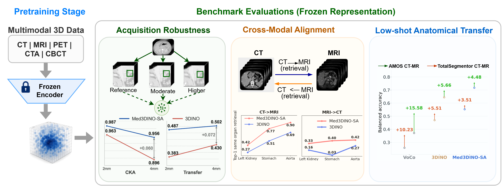

# REFORM-3D

**A Representation-Centric Evaluation Framework for 3D Medical Vision Foundation Models**

[](https://endarzboy.github.io/reform3d-website/)
[](#publication)
[](#publication)
[](docs/encoders.md#med3dino-checkpoints)
[](notebooks/00_case_selection.ipynb)
[](#pretraining)

REFORM-3D helps researchers compare **frozen 3D medical encoders before downstream adaptation**. It evaluates how representations respond to voxel spacing, align anatomy across CT and MR, and support organ recognition from a few labeled examples.



| Module | Question | Primary metrics |
|---|---|---|
| Acquisition robustness | How do features change under controlled spacing changes? | Embedding drift, centered kernel alignment (CKA), matched semantic transfer |
| Cross-modal alignment | Can an organ in CT retrieve the same anatomy in MR, and vice versa? | Bidirectional retrieval mAP, Top-1, Top-5 |
| Anatomical generalization | How well do a few labeled examples support recognition on separate cases? | Centroid and logistic-probe balanced accuracy, adaptation gain |

The YAML workflow supports registered **Med3DINO and 3DINO** checkpoints. External encoders use dedicated adapters. The examples below use KiTS23 and MMWHS; [custom datasets](docs/data.md#custom-datasets) can be supplied through manifests. You can also [load frozen features directly](docs/encoders.md#use-frozen-features-downstream) for your own downstream pipeline.

Compare these properties separately: stable embeddings alone do not establish useful anatomy, and the results do not guarantee a downstream winner. Low-shot probes fit labeled readouts while the encoder remains frozen. See the [project website](https://endarzboy.github.io/reform3d-website/#findings) for selected manuscript findings.

## Installation

Use **Python 3.11 on Linux**. The supplied constraints target **PyTorch 2.4.0 with CUDA 12.1**:

```bash
git clone https://github.com/Endarzboy/REFORM3D.git
cd REFORM3D
python3.11 -m venv .venv
source .venv/bin/activate
python -m pip install -c requirements.txt .
```

`requirements.txt` constrains dependency versions, including PyTorch and CUDA libraries. GPU evaluation requires a compatible NVIDIA driver. If you use a different PyTorch/CUDA combination, update the constraints together.

For the bundled SAM-Med3D, MiM, and GL-MAE adapters, install `'.[external]'` instead of `.`. Other adapters may require upstream code or a separate environment; see [External encoders](docs/encoders.md#external-encoders).

## Checkpoints

| Encoder | YAML key | Input tensor | Backbone parameters | Weights |
|---|---|---|---:|---|
| Med3DINO-ISO | `med3dino_iso_96` | `B × 1 × 96³` | 306.78M | Hugging Face link pending |
| Med3DINO-REL | `med3dino_rel_96` | `B × 1 × 96³` | 306.78M | Hugging Face link pending |
| Med3DINO-SA | `med3dino_sa_96` | `B × 1 × 96³` | 306.78M | Hugging Face link pending |
| 3DINO | `3dino` | `B × 1 × 112³` | 306.91M | Obtain upstream 3DINO weights |

All four use ViT-L/16 backbones with 1,024-dimensional CLS and average-pooled patch features. ISO, REL, and SA refer to isotropic normalization, voxel-relative sampling, and spacing-aware sampling during Med3DINO pretraining. Parameter counts include positional and mask tokens and exclude pretraining projection heads. Physical field of view depends on preprocessing as well as tensor dimensions.

Set local weight paths with `checkpoint_paths`, as shown below, or use the directory layout in the [checkpoint guide](docs/encoders.md#med3dino-checkpoints). Weight files must match the registered architecture. Med3DINO download links are pending; weight binaries are distributed separately from this repository.

## Data preparation

Obtain the annotated datasets from their providers:

- **KiTS23 CT:** [official download instructions](https://github.com/neheller/kits23#data-download) and [provider imaging files](https://huggingface.co/datasets/neheller/KiTS-Challenge-Imaging).
- **MMWHS CT/MR:** [official access page and agreement](https://zmiclab.github.io/zxh/0/mmwhs/), with the provider's [download folder](https://mega.nz/folder/UNMF2YYI#1cqJVzo4p_wESv9P_pc8uA).

Keep data and weights outside the repository. REFORM-3D accepts these layouts:

```text
KiTS23/
├── images/
│   └── case_00000_ct.nii.gz
└── masks/
    └── case_00000_mask.nii.gz

mm_whs/
├── ct_train/
│   ├── ct_train_1001_image.nii.gz
│   └── ct_train_1001_label.nii.gz
└── mr_train/
    ├── mr_train_1001_image.nii.gz
    └── mr_train_1001_label.nii.gz
```

The tree illustrates naming; evaluation requires multiple annotated cases. The KiTS23 download uses per-case directories: the [data guide](docs/data.md) explains how to create this layout without resampling images or masks. MMWHS `.nii` files are also supported. Follow the providers' access and usage terms.

## Evaluation

Start from [mmwhs-demo.yaml](configs/mmwhs-demo.yaml) for CT–MR alignment and anatomical generalization, or [kits23-demo.yaml](configs/kits23-demo.yaml) for acquisition robustness. For example, save the following as `configs/my-mmwhs.yaml` and replace the data and weight paths:

```yaml
dataset: mmwhs_ct_mr
data_root: /path/to/mm_whs
checkpoint_paths:
  med3dino_rel_96: /path/to/c96_rel_teacher_checkpoint.pth
  med3dino_sa_96: /path/to/c96_sa_teacher_checkpoint.pth
checkpoints: [med3dino_rel_96, med3dino_sa_96]
workspace: ../workspace
run_name: my-mmwhs-evaluation
preset: demo
seeds: [42]
feature_types: [cls]
device: cuda:0
batch_size: 1
```

Relative paths resolve beside the YAML file, so `workspace: ../workspace` places outputs at the repository root. The `demo` preset evaluates the selected cohort; it does not automatically reduce its size.

Validate the inputs, then run:

```bash
reform3d check --config configs/my-mmwhs.yaml
reform3d run --config configs/my-mmwhs.yaml
```

`check` validates inputs and prepares the manifest without encoder inference. `run` extracts features, evaluates the selected modules, and writes reports. To compare both readouts, set `feature_types: [cls, avg_pool]`. For repeated evaluation, set `seeds: [42, 123, 456]`.

Use a new `run_name` when configuration, inputs, weights, or software change. Compatible completed work is reused after integrity checks. See [Usage](docs/usage.md) for configuration options and reuse rules.

## Results and reports

Open `workspace/runs/mmwhs_ct_mr/_runs/my-mmwhs-evaluation/report.html` for the combined report. Each module also has its own report and encoder outputs:

```text
workspace/
├── manifests/mmwhs_ct_mr/
├── cache/mmwhs_ct_mr/              # preprocessed inputs
└── runs/mmwhs_ct_mr/
    ├── _runs/my-mmwhs-evaluation/  # combined report and run receipt
    ├── cross_modal/my-mmwhs-evaluation/
    │   ├── report.html
    │   ├── scores.csv
    │   ├── logs/
    │   └── seeds/seed_42/<encoder>--cls/
    │       ├── cross_modal.json
    │       └── features/
    │           ├── organ_features.npz
    │           └── identity.json
    └── anatomical/my-mmwhs-evaluation/
```

Features live inside each encoder's `features/` directory. Compatible runs share their storage through filesystem hard links; `cache/` contains only preprocessed inputs. Acquisition features use `controlled_embedding_bundle.npz` in the same per-encoder location. See the [full output layout](docs/usage.md).

For KiTS23, open `workspace/runs/kits23/acquisition/<run_name>/report.html`. Tables compare encoders separately for CLS and average-pooled patches, with sortable module-specific metrics. Reports identify the evaluated cohort and summarize variation across evaluation seeds; these are fixed-checkpoint comparisons, not independent pretraining runs.

Rebuild a report from saved results without running inference:

```bash
reform3d report --run-dir workspace/runs/mmwhs_ct_mr/_runs/my-mmwhs-evaluation
```

## Visualization notebooks

Compare ISO, REL, and SA features on **CT and MR axial slices** using identical inputs for each encoder. The examples use KiTS23 CT and BraTS2023 FLAIR MR scans.

| Notebook | Purpose |
|---|---|
| [00 · Input preview](notebooks/00_case_selection.ipynb) | Preview and save shared 96³ crops for PCA. |
| [01 · Reference-feature similarity](notebooks/01_attention.ipynb) | Overlay patch-feature cosine similarity on uncropped CT/MR frames. |
| [02 · PCA](notebooks/02_pca.ipynb) | Visualize spatial variation in patch features across the shared crops. |

Install the notebook tools and create your local configuration:

```bash
python -m pip install -c requirements.txt '.[notebooks]'
cp notebooks/visualization_config.example.json notebooks/visualization_config.json
```

Edit the image, mask, and checkpoint paths, set reference points for your own scans, then launch `jupyter lab`. The `pca` and `similarity` sections share checkpoints but require separate output directories. Obtain scans and weights from their providers.

The similarity notebook preserves the full field of view on a shared isotropic model grid with a maximum axis of 224 voxels, then overlays cosine similarity on up to five native-resolution axial frames. Features are extracted once and reused for new reference points or slices. Ground truth supplies optional contours; these maps illustrate feature similarity, not segmentation accuracy. PCA colors are fitted independently for each encoder and are not directly comparable across encoders. The [visualization guide](docs/visualization.md) explains geometry, compute requirements, and display controls.

## Documentation

- [Data](docs/data.md): downloads, layouts, manifests, and custom datasets.
- [Encoders](docs/encoders.md): checkpoint specifications and frozen-feature loading.
- [Usage](docs/usage.md): configuration, caching, and reports.
- [Visualization](docs/visualization.md): CT/MR reference-feature similarity and PCA notebooks.
- [Reproducibility](docs/reproduction.md): KiTS23/MMWHS evaluation protocols.
- [Integrity](docs/audit.md): required input, cache, and output checks.

## Publication

Paper and arXiv URLs are pending. This repository provides the standalone evaluation tool; it does not promise full-paper table regeneration or exact historical numerical parity.

## Pretraining

**Med3DINO pretraining repository: forthcoming.** Its link will be added here when published. The frozen encoder runtime is bundled in `src/reform3d/`; using REFORM-3D does not require the pretraining checkout.

## License

See [LICENSE](LICENSE) for this repository and [Source notices](docs/LICENSES/README.md) for bundled components. Dataset and weight terms remain those of their respective providers.
