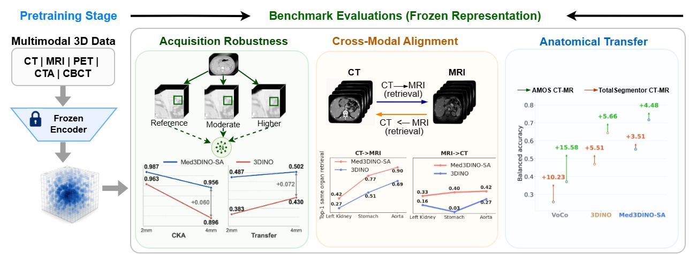

<div align="center">
  <h1 align="center"><picture><source media="(prefers-color-scheme: dark)" srcset="docs/assets/reform3d-wordmark-dark.svg"></picture></h1>
  <h2 align="center">A Representation-Centric Evaluation Framework for<br>3D Medical Vision Foundation Models</h2>
  <p align="center">
    <a href="https://scholar.google.nl/citations?user=XR6wzDQAAAAJ&amp;hl=en">Maregu Assefa</a><sup>1</sup>,
    <a href="https://scholar.google.nl/citations?user=tM9xKA8AAAAJ&amp;hl=en">Muzammal Naseer</a><sup>1,2</sup>,
    <a href="https://scholar.google.nl/citations?user=-ouVDccAAAAJ&amp;hl=en">Divya Velayudhan</a><sup>1</sup>,
    <a href="https://scholar.google.nl/citations?user=dbrVI_oAAAAJ&amp;hl=en">Gedamu Alemu Kumie</a><sup>1</sup>,
    <a href="https://scholar.google.nl/citations?user=G_2Xpm0AAAAJ&amp;hl=en">Naoufel Werghi</a><sup>1</sup>
  </p>
  <p align="center"><sup>1</sup> Department of Computer Science, Khalifa University, Abu Dhabi, UAE<br>
  <sup>2</sup> University of Western Australia</p>
</div>

<p align="center">
<a href="https://endarzboy.github.io/reform3d-website/"></a>
<a href="#publication"></a>
<a href="https://huggingface.co/maregu2023/Med3DINO"></a>
<a href="notebooks/visualize_PCA.ipynb"></a>
</p>

REFORM-3D helps researchers compare **frozen 3D medical encoders before downstream adaptation**. It measures representation stability under voxel-spacing changes, anatomical alignment across CT and MR, and organ recognition from a few labeled examples.



| Module | Question | Primary metrics |
|---|---|---|
| Acquisition robustness | Are features stable and semantically useful across controlled spacing changes? | Embedding drift ↓, centered kernel alignment (CKA) ↑, matched semantic-transfer balanced accuracy ↑ |
| Cross-modal alignment | Can CT retrieve the same organ in MR, and vice versa? | Bidirectional retrieval mAP ↑, Top-1 ↑, Top-5 ↑ |
| Anatomical generalization | Can a few labeled examples support organ recognition on separate cases? | Centroid and logistic-probe balanced accuracy ↑, adaptation gain |

The examples use **KiTS23** for acquisition robustness and **MMWHS** for cross-modal alignment and anatomical generalization, comparing **Med3DINO-ISO, REL, and SA**. Annotated CT–MR datasets can use the [custom-organ workflow](docs/usage.md#custom-datasets).

Encoders remain frozen throughout evaluation; low-shot probes fit labeled readouts. See the [project website](https://endarzboy.github.io/reform3d-website/#findings) for selected manuscript findings.

## Installation

The supplied dependency constraints were validated with **Python 3.11 on Linux**, **PyTorch 2.4.0**, and **CUDA 12.1**. GPU evaluation requires a compatible NVIDIA driver.

```bash
git clone https://github.com/Endarzboy/REFORM3D.git
cd REFORM3D
python3.11 -m venv .venv
source .venv/bin/activate
python -m pip install -c requirements.txt -e .
```

For additional encoders, follow the [adapter-specific setup instructions](docs/usage.md#external-encoders).

## Checkpoints

Download the selected Med3DINO weights from [Hugging Face](https://huggingface.co/maregu2023/Med3DINO/tree/main) for evaluation and PCA visualization.

| Encoder | YAML key | Evaluation input | Backbone parameters | Weights |
|---|---|---|---:|---|
| Med3DINO-ISO | `med3dino_iso_96` | `B × 1 × 96³` | 306.78M | [Med3DINO-ISO](https://huggingface.co/maregu2023/Med3DINO/resolve/3404b24c7fb060215c15998aec6de42c7d6febc1/med3dino_iso/c96_iso_teacher_checkpoint.pth) |
| Med3DINO-REL | `med3dino_rel_96` | `B × 1 × 96³` | 306.78M | [Med3DINO-REL](https://huggingface.co/maregu2023/Med3DINO/resolve/3404b24c7fb060215c15998aec6de42c7d6febc1/med3dino_rel/c96_rel_teacher_checkpoint.pth) |
| Med3DINO-SA | `med3dino_sa_96` | `B × 1 × 96³` | 306.78M | [Med3DINO-SA](https://huggingface.co/maregu2023/Med3DINO/resolve/3404b24c7fb060215c15998aec6de42c7d6febc1/med3dino_sa/c96_sa_teacher_checkpoint.pth) |

All three use ViT-L/16 backbones with 24 transformer blocks and 16 attention heads. Their `96³` evaluation inputs produce a `6 × 6 × 6` patch grid. CLS and average-pooled patch features (`cls` and `avg_pool`) have 1,024 dimensions. ISO, REL, and SA refer to isotropic normalization, voxel-relative sampling, and spacing-aware sampling during Med3DINO pretraining. Parameter counts include positional embeddings and mask tokens, excluding pretraining projection heads.

Set `checkpoint_root` to a directory with this layout, including the files for your selected encoders:

```text
checkpoints/
├── med3dino_iso/c96_iso_teacher_checkpoint.pth
├── med3dino_rel/c96_rel_teacher_checkpoint.pth
└── med3dino_sa/c96_sa_teacher_checkpoint.pth
```

The download links select a fixed weight revision. [Checkpoint metadata](docs/checkpoints.json) records filenames, sizes, and SHA-256 hashes; the [Hugging Face download guide](https://huggingface.co/maregu2023/Med3DINO#download) provides CLI commands and checksum verification. Alternatively, map registry keys to explicit local files:

<details>
<summary>Configure explicit checkpoint paths</summary>

```yaml
checkpoints: [med3dino_iso_96, med3dino_rel_96, med3dino_sa_96]
checkpoint_paths:
  med3dino_iso_96: /path/to/iso_teacher.pth
  med3dino_rel_96: /path/to/rel_teacher.pth
  med3dino_sa_96: /path/to/sa_teacher.pth
feature_types: [cls, avg_pool]
```

Paths resolve relative to the YAML file. The loader requires all backbone weights with compatible shapes and permits unused pretraining heads.

</details>

## Data preparation

Obtain the annotated datasets from their providers:

- **KiTS23 CT:** [official download instructions](https://github.com/neheller/kits23#data-download) (`kits23_download_data`) and [provider imaging files](https://huggingface.co/datasets/neheller/KiTS-Challenge-Imaging).
- **MMWHS CT/MR:** [official access page and agreement](https://zmiclab.github.io/zxh/0/mmwhs/), with the provider's [download folder](https://mega.nz/folder/UNMF2YYI#1cqJVzo4p_wESv9P_pc8uA).

Keep full evaluation datasets and weights outside Git. Prepare the annotated training cohorts using these layouts:

```text
KiTS23/
├── images/
│   └── case_00000_ct.nii.gz
└── masks/
    └── case_00000_mask.nii.gz

mm_whs/
├── ct_train/
│   ├── ct_train_1001_image.nii.gz
│   └── ct_train_1001_label.nii.gz
└── mr_train/
    ├── mr_train_1001_image.nii.gz
    └── mr_train_1001_label.nii.gz
```

These single-case entries illustrate naming; evaluation requires a complete, eligible cohort. MMWHS also accepts `.nii` files; CT and MR case IDs do not imply paired scans of the same patient.

<details>
<summary>Prepare the KiTS23 layout from the original per-case folders</summary>

The provider layout contains `case_00000/imaging.nii.gz` and `case_00000/segmentation.nii.gz` under `kits23/dataset/`. Edit the two paths below and run once to create named symbolic links without resampling:

```python
from pathlib import Path

source = Path("/path/to/kits23/dataset").resolve()
target = Path("/path/to/KiTS23").resolve()
cases = sorted(source.glob("case_*"))
if not cases:
    raise FileNotFoundError("No KiTS23 case directories found")
pairs = []
for case in cases:
    for src_name, folder, suffix in [
        ("imaging.nii.gz", "images", "ct"),
        ("segmentation.nii.gz", "masks", "mask"),
    ]:
        src = case / src_name
        dst = target / folder / f"{case.name}_{suffix}.nii.gz"
        if not src.is_file():
            raise FileNotFoundError(src)
        if dst.exists() or dst.is_symlink():
            raise FileExistsError(dst)
        pairs.append((src, dst))
for src, dst in pairs:
    dst.parent.mkdir(parents=True, exist_ok=True)
    dst.symlink_to(src)
```

If your data already match the expected layout, skip this step. Keep the original files in place so the links remain valid.

</details>

## Evaluation

Copy the example configurations:

```bash
cp configs/kits23-demo.yaml configs/my-kits23.yaml
cp configs/mmwhs-demo.yaml configs/my-mmwhs.yaml
```

In each copy, set `data_root`, `checkpoint_root` (or `checkpoint_paths`), and `device`. Relative paths resolve beside the YAML file; `workspace: ../workspace` places artifacts at the repository's `workspace/` directory.

Both examples select REL and SA, CLS features, and seed 42. The `demo` preset uses the full selected cohort. KiTS23 runs acquisition robustness; MMWHS runs both organ modules.

Check the inputs, then evaluate:

```bash
reform3d check --config configs/my-kits23.yaml
reform3d run --config configs/my-kits23.yaml

reform3d check --config configs/my-mmwhs.yaml
reform3d run --config configs/my-mmwhs.yaml
```

`check` validates inputs and prepares manifests and evaluation plans without encoder inference. It also requires the selected checkpoint files to exist. `run` extracts features, evaluates the selected modules, and writes reports.

To compare all three Med3DINO variants and both main readouts over three seeds, update these fields and supply all three checkpoint files:

```yaml
checkpoints: [med3dino_iso_96, med3dino_rel_96, med3dino_sa_96]
feature_types: [cls, avg_pool]
seeds: [42, 123, 456]
```

Use a new `run_name` when configuration, inputs, weights, or software change. Evaluation plans share case selections across encoders and readouts within each module and seed. For repeatable results, keep inputs, weights, code, dependencies, hardware, and numerical settings fixed. See the [reproducibility guidance](docs/usage.md#reproducibility).

## Results and reports

Each run generates an HTML report, CSV scores, and JSON results. Artifacts are organized by dataset, module, seed, encoder, and readout:

```text
workspace/
├── manifests/<dataset>/                    # inputs and evaluation plans
├── cache/<dataset>/                        # preprocessed inputs
└── runs/<dataset>/
    ├── _runs/<run_name>/                   # combined report for multi-module runs
    └── <module>/<run_name>/
        ├── report.html
        ├── scores.csv
        ├── profile.json
        ├── run.json
        ├── logs/
        └── seeds/seed_<N>/<encoder>--<readout>/
            ├── <module>.json
            └── features/                  # embeddings and identity metadata
```

Open the module's `report.html` for sortable encoder comparisons by readout, including variation across seeds. For MMWHS, `_runs/<run_name>/report.html` combines both modules.

To regenerate the combined MMWHS report from saved results, use the configured run name (the example defaults to `mmwhs-demo`):

```bash
reform3d report --run-dir workspace/runs/mmwhs_ct_mr/_runs/mmwhs-demo
```

This reads saved metrics; it does not rerun encoder inference.

## Use frozen features downstream

`create_feature_extractor` loads the encoder in evaluation mode with frozen parameters. Supply a preprocessed tensor with spatial axes `[D, H, W]`. The evaluation pipeline clips each source volume at its 0.05th and 99.95th intensity percentiles and scales intensities to `[-1, 1]`:

```python
import torch
from reform3d.encoders.factory import create_feature_extractor

encoder = create_feature_extractor(
    "med3dino_sa_96",
    checkpoint_path="/path/to/c96_sa_teacher_checkpoint.pth",
    device="cuda:0",
)
# batch is your preprocessed [B, 1, 96, 96, 96] tensor.
with torch.inference_mode():
    features = encoder.extract(batch, normalize=True)
    global_features = features["cls"]       # [B, 1024]
    pooled_features = features["avg_pool"]  # [B, 1024]
```

`cls` is the global token; `avg_pool` averages the final patch tokens. `multilayer` concatenates the last four CLS vectors into `[B, 4096]`. `normalize=True` L2-normalizes embeddings, not image intensities. For comparisons, use the [evaluation workflow](#evaluation) for module-specific preparation; tensor shape alone does not specify physical coverage.

## PCA visualization

The [PCA notebook](notebooks/visualize_PCA.ipynb) compares ISO, REL, and SA using a shared CT crop or full-volume MR. The [BraTS2023 FLAIR MR example and mask](notebooks/example_cases/MR/BraTS-GLI-00002-000/) are included. Download KiTS23 CT case **`case_00001`** separately using the [dataset instructions](#data-preparation).

<!-- Set `checkpoint_dir` and `device`, run the shared setup cell, then run the CT or MR cell independently. Relative checkpoint paths resolve from the kernel's working directory. For CT, update the image and mask paths in `cases` to your local `case_00001` files. -->

<!-- ```bash
python -m pip install -c requirements.txt -e '.[notebooks]'
jupyter lab notebooks/visualize_PCA.ipynb
``` -->

## Documentation

- [Usage](docs/usage.md): configuration, custom datasets, external encoders, feature reuse, reports, and reproducibility.

## Publication
Please cite REFORM-3D when using the framework or Med3DINO checkpoints:

```bibtex
@InProceedings{assefa_reform3d,
  title = {REFORM-3D: A Representation-Centric Evaluation Framework for 3D Medical Vision Foundation Models},
  author = {Assefa, Maregu and Naseer, Muzammal and Velayudhan, Divya and Kumie, Gedamu Alemu and Werghi, Naoufel},
  booktitle = {Neural Information Processing Systems (NeurIPS 2026)},
  year = {2026},
  pages ={1--32},
  url = {https://endarzboy.github.io/reform3d-website/}
}
```

## License

REFORM-3D's own code is covered by [LICENSE](LICENSE). Med3DINO checkpoint weights are offered under **CC BY-NC 4.0**; see the [checkpoint metadata](docs/checkpoints.json). Bundled components retain their original [source notices](docs/LICENSES/README.md).
